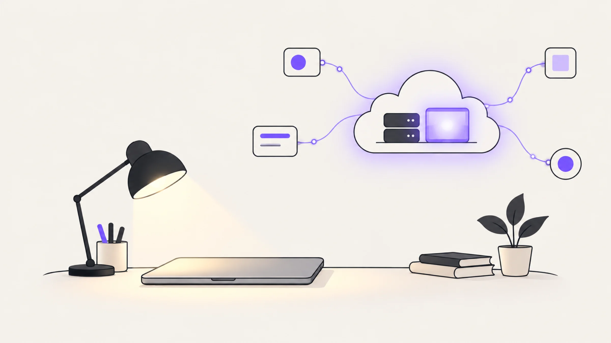
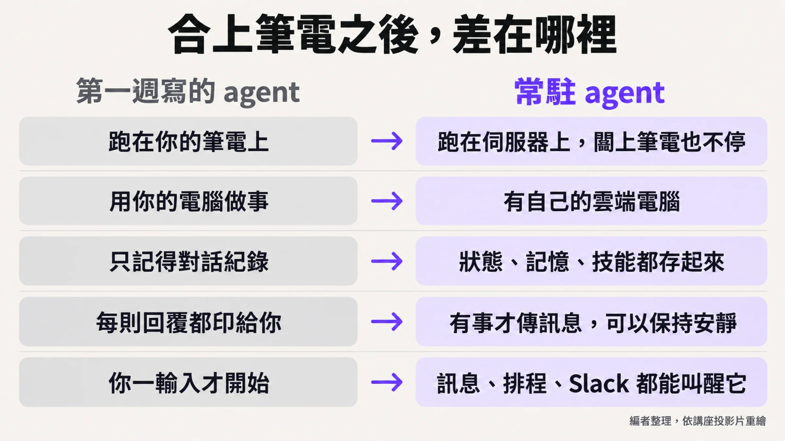
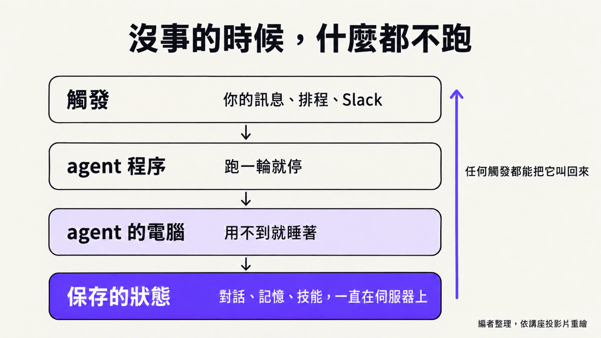
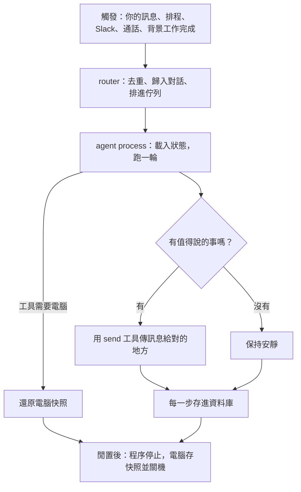
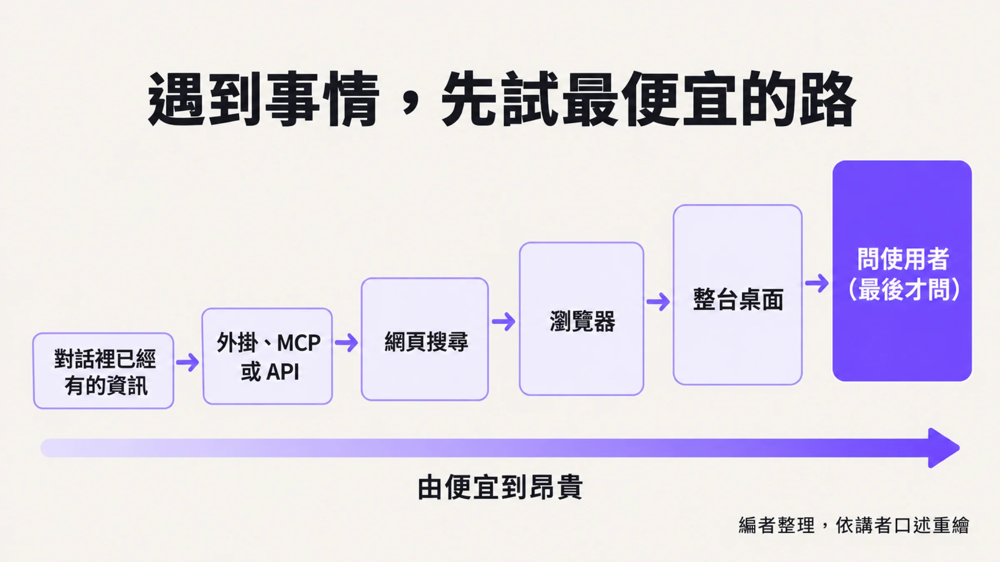
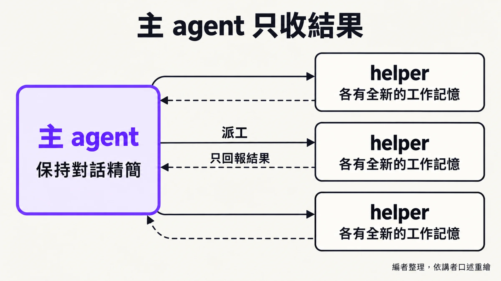
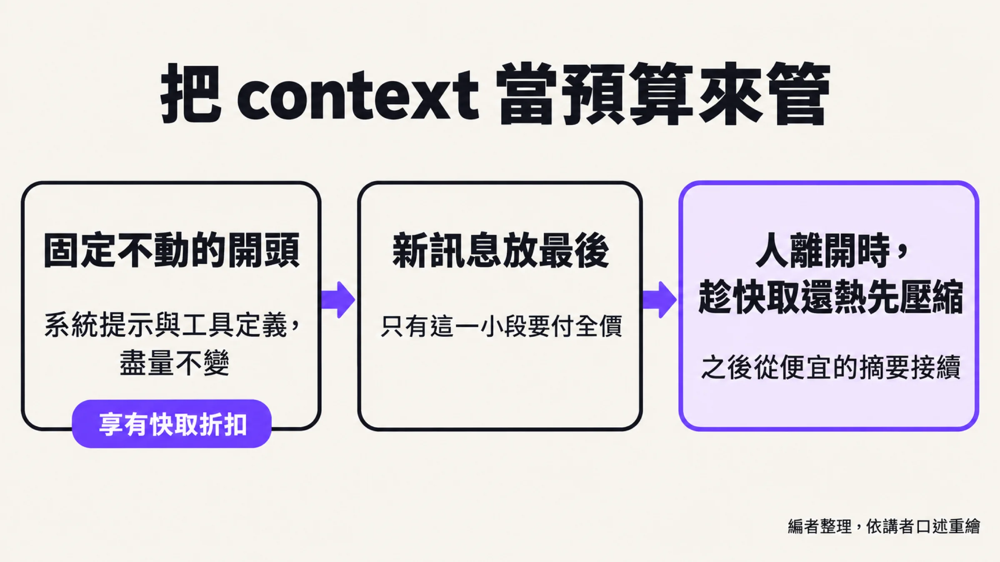
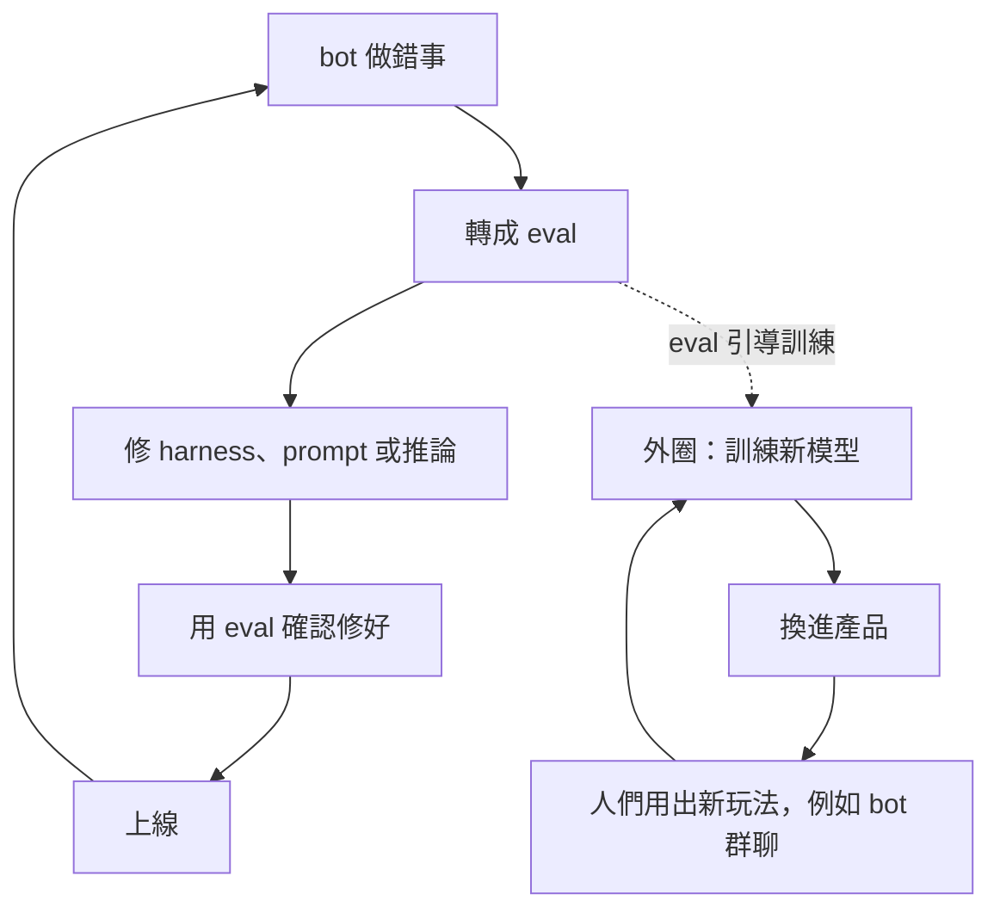

# 合上筆電之後，agent 還在做事

*圖：編者整理並繪製的概念圖，非講者原圖。*

## 摘要

史丹佛 CS146S 的一堂講座，Lee Robinson 講的是 Grok Bot 這類常駐 agent 的做法。第一週學生寫的「模型加工具迴圈」，筆電一闔就停了；要讓它活過當機、更新與一整晚，得替它配一台雲端電腦、讓程序與電腦在沒事時睡著、把狀態全存在伺服器，再用 prompt cache、壓縮與分層記憶守住 context。他假設模型只會變強，產品能少做就少做。本文依講座內容整理，講者的 6 至 12 個月預測保留為預測。

## 講者是誰，憑什麼談這件事

講者是 Lee Robinson，網路上多用 leerob 這個名字。以下多數來自他自己的網站 [leerob.com](https://leerob.com/) 與 [Cursor 經歷頁](https://leerob.com/cursor)，屬他本人的說法。

他自述寫了十五年程式，後半段在教人；更早在 Vercel 做 Next.js。2025 年 7 月到 2026 年 8 月他在 Cursor，進去時公司約 70 人，第一年是橫跨工程、產品與行銷的通才：做文件與學習課程，講過 context engineering 和 Cursor 自家的 Composer 模型，替不少產品發布當半個 PM。2026 年 6 月，他轉去做 ML，說自己想訓練出「great colleagues」那樣的模型。現在他的首頁寫著：在 SpaceX 做 ML，幫忙訓練有用的 AI 模型。

這條履歷和 Cursor 的結局有交會。Cursor 在 2026 年 8 月 14 日宣布被 SpaceX 正式收購（[Cursor 公告](https://cursor.com/blog/joining-spacex)），所以他在講座裡才會說「at Cursor … and now at SpaceX」。講座談到 Grok Bot 時，他用的是「我們」，例如提到有人 fork 了「我們」的程式碼。

編者對照（非講者所述）：他講過的 context engineering，對得上本文「把 context 當預算來管」那一節；他從產品轉到訓練模型，也對得上講座後半談的訓練飛輪。要留意的是，他的頁面沒有寫他在 SpaceX 的正式職稱，也沒說他在 Grok Bot 專案裡負責哪一塊，這兩件事本文不替他補。

## 筆電一闔就停的 agent

學生在第一週寫的那個 agent，筆電一闔就停了。講者自己講得直白：「you close your laptop and the process stops.」模型呼叫工具、跑在迴圈裡，這個核心很強，但也有缺點。

他要談的是把它搬到伺服器上的版本。它可以在雲端跑，電腦闔上、程序重啟、當機之後都還活著；它有一台自己的 Linux 電腦，裡面有桌面、檔案、瀏覽器，還會慢慢累積對你的了解。最大的差別在互動方式：不像終端機裡的 harness（代理運作框架）逐句回應，它「more like a colleague」，「It knows when to be quiet.」，可能默默做事，等有重要進展才來找你。喚醒它的也不只是你打字，Slack 訊息、email 或其他事件都可以。講者期待這類 agent 能連續做上幾小時、幾天，甚至「maybe even weeks or months」，而這需要不同的架構。

*圖：編者整理，依講座投影片重繪，非講者原圖。*

## 從逐條核准，到邊做邊插話

講者把開發者與 AI 的合作分成四個時期：複製貼上、終端機裡的 agent、為 agent 打造的專屬 app，以及現在的常駐 agent。投影片把前三個標成 2022–23、2024–25、2025–26。第三期的痛點他講得具體：人同時跑很多 agent，卻是瓶頸，因為「you were reviewing every command that they were running.」

現在的做法是插話引導。他舉的例子是先說「Hey, go check this thread.」，緊接著補一句「actually go do that on Thursday」。講者說，前幾代模型被打斷會搞混，現在的模型與 harness 處理得來。配套是 auto review：由另一個 AI 模型檢查所有要執行的指令。講者說不少公司都這麼叫它，並且主張這比人「watch hundreds of shell commands」的疲勞更安全；他說現在大概到了這種程度：如果拿模型和人的檢查來做盲測，多數時候模型做得比較好。這是單一來源的說法。

介面反而變簡單了。這類他們叫作 bot 的產品最近冒出不少，他認為主因是「we all know how to text」，所以和 AI 合作被壓縮成像傳訊息給朋友。

## 模型哪裡變了

講者說他挑六項講，實際上還有更多。第一項是長時間照指示做事，他說模型現在「pretty confidently」能跑幾小時到幾天，前提是壓縮得宜。能把工作交給 sub-agent，每個 helper 有全新的工作記憶，主 agent 的 context 就不會被塞滿。工具呼叫成熟了，他說幻覺現在「kind of a solved problem mostly」。能操作電腦，沒有 API 或 MCP 的網站也能用。資訊都存成檔案，模型很擅長用 shell 指令搜尋。最後是看人示範，就把流程存成 skill、記憶或 routine。

這些合在一起，他用一句話收束：「everything is computer」。記憶是檔案，skills 是 markdown，routine 則像 cron job，是照排程跑的 prompt。他舉的小例子是使用者喜歡小寫訊息，這條偏好得出現在每一則 prompt 裡，否則偶爾冒出大寫會很怪。

## 沒事的時候，什麼都不跑

「常駐」聽起來像永遠開著，講者畫的圖卻是反過來：伺服器是睡著的，agent 能使用的電腦也是睡著的。訊息或觸發一來，才載入狀態開機；需要用電腦，才把電腦叫醒；做完再讓兩邊睡回去。理由很務實：既貴，而且「there's not enough computers in the world」讓每個人的電腦全天候開著。狀態（對話紀錄、記憶、routine）則存進資料庫。

*圖：編者整理，依講座投影片重繪，非講者原圖。*

投影片寫的是 agent 程序閒置 2 分鐘後停止，電腦則在最後一次活動幾分鐘後存快照關機、不會在一輪進行到一半時關；「2 分鐘」講者沒有說出口。

*圖：編者整理，依講者口述與投影片流程圖重畫，非講者原圖。*

喚醒 agent 的不只是你。講者覺得越來越有意思的，是背景有別的東西決定何時去找你的 bot：有人在 Slack 點你、你把 bot 放進一場會議。他說這在 SpaceX「increasingly common now」，員工沒法出席的會，讓 bot 去做筆記再回報，他自己覺得有點好笑。這些事件先進 router 去重、歸進某段對話，再由 bot 判斷要不要去打擾使用者。道理跟同事一樣，每有一點進展就跑來報告會很煩，狀態更新大概一天一次就夠，視任務而定。

那台電腦跑的是 Firecracker 虛擬機，好處是容易拍下整台機器的狀態、關掉、再開。你可以連進去看即時畫面，必要時親自接手；要跑五個、十個 bot 各用一個瀏覽器，就給它們不同的虛擬螢幕。

## agent 住在伺服器，電腦可以隨時重建

為什麼 agent loop 放在伺服器？講者先給了老派理由：瘦客戶端、重量級伺服器是計算領域常見的做法，業界多年來也在胖瘦兩端來回擺盪；更新不必過 App Store 審查，重運算在伺服器上通常比較快（看裝置而定），伺服器擴充的方法也成熟。他說最關鍵的是另一條：若把 loop 放在虛擬機裡，就落入「you can't shut down the virtual machine independently」的處境，電腦沒法獨立於 agent server 關掉。所以東西都存在伺服器上，電腦才能隨時重建。他的例子是 Linux 要緊急補零日漏洞，想重建那台 VM，卻不想連 agent loop 一起炸掉、讓應用程式停機。

另一個基礎元件是 durable workflow（耐久工作流程）。一般 job queue 在第三步當機，重來就得把一、二、三步再跑一遍；durable workflow 重試時則是「it picks right up on step three」。講者說他們用開源的 Temporal，免得自己從零打造這套複雜機制，但基礎設施還是得自己養。每個 helper 本身也是一個 durable workflow，影片 helper 把記憶體吃光崩掉，可以重啟、不丟進度。

訊息怎麼排隊，也有規矩。你自己直接傳訊息給 bot，優先權最高，現行的 loop 會停下來；群組聊天、Slack thread、背景 routine 的訊息排到隊伍後面，短時間湧進三、四則會合併成一輪。講者說這個啟發式想怎麼訂都行。

## 一條通道、一道階梯

harness 這一層，講者說 Grok Bot（他說市面上一些同類工具大概也是）最大的差別，在客戶端與伺服器之間「only one tool that communicates」，叫 send user（投影片寫作 SendToUser）。客戶端「is just texting the server in some ways」，shell、讀檔、叫雲端 agent、錄螢幕這些重工具都在伺服器端。收到訊息後，客戶端自己決定怎麼呈現：登入表單接 1Password、付款走 Stripe Link 或 X Money、不可逆的寄信先給你改稿核准，有時只丟一個 emoji 表情回應。

投影片同一頁還列了兩張卡：「Thinking stays private」，模型的一般文字不會顯示給你；「Quiet is allowed」，沒有新進展就不發訊息。編者讀法（非講者原話）：只留一條 send 通道，不出聲就成了預設。至於什麼時候該開口，講者說那是另一套啟發式，團隊還在調。

工具太多會吃掉 context。講者介紹的是不少熱門 harness 都在用的做法（有人叫它 tool search tool）：只把工具名稱放進每則訊息，模型要用再去讀細節，「files and a file system all the way down」。處理一件事時，順序是「try the cheapest option or the most reliable option first」：先看對話裡已經有的資訊，接著是 plugin、MCP、API（他舉 Plaid 抓銀行資料），再來網頁搜尋、瀏覽器，然後整台桌面，全部失敗才問使用者。這個階梯有個容易讀反的地方：問使用者放最後，講的是 agent 還有別條路可以先試的情形；寄信這類不可逆的動作，他說的是要先問使用者。

*圖：編者整理，依講者口述重繪，非講者原圖。*

整個結構的中心是 orchestrator：主 agent 盡量保持對話精簡，把花 token 的活交給 helper，helper 做完只回報結果，「None of that is bloating the conversation」。講者承認「infinite context is not a real thing」，但這類做法加上訓練，可以讓人感覺不到撞牆。他的幾條實務心得：「ideally you don't add or remove new tools during turns」；若看到模型有九成時間在用 shell 做同一件事，專用工具「can be more efficient」，審查的人也比較看得懂。

*圖：編者整理，依講者口述重繪，非講者原圖。*

## 把 context 當預算來管

講者說 context engineering 跟 harness engineering 他覺得「kind of the same thing」。核心是 prompt cache：每次都重送整段對話，快取過的 token 有大幅折扣，所以工具定義、系統提示要「as static as possible」，新訊息放最後，只有這一段要付未快取的價。cache miss 在他眼裡「kind of like a bug in the system really」。

他舉的例子是 2026 年 1 月前後 OpenClaw（開源的個人 AI 助理，repo 為 openclaw/openclaw）正紅，使用者把它掛在模型供應商的訂閱方案底下，這是「a very new usage pattern」，harness 還沒為它最佳化，cache miss 很多，後來補了很多修正。他分享的小招：提示的各區段各自 hash、維持固定順序，做 A/B 測試加一段新提示時才不會弄壞所有人的快取；使用者一開始打字，伺服器就先組好 prompt 暖快取。

壓縮是躲不掉的：以 20 萬 token 的視窗為例，聊久了總會滿。他的提醒是「all compression is lossy」，並說他相信光這個問題就夠寫好幾本博士論文。他們的做法是趁使用者剛離開、快取還暖著的時候（他說可能 10 分鐘，也可能 60 分鐘）就先壓縮，等使用者 30 分鐘後回來，已經是從便宜的摘要接續。

*圖：編者整理，依講者口述重繪，非講者原圖。*

記憶分幾層，講者自己說是「in a few different layers」：每次都要帶的核心事實（理想上要有類似垃圾回收的機制來挑選）、帶日期的歷史日誌、只管三十分鐘到一小時的便條，其餘的都放在檔案裡，需要時查。投影片另寫了 profile 最多 100 條事實、日誌取最相關 30 筆，這些數字同樣不是講者口述。

## 訓練飛輪，與「刪掉產品」

談訓練，講者先複習三階段：預訓練、監督式微調（讓模型見過這套 harness 的工具與格式）、強化學習（長指令遵循、在數百個 skill 中選對的、在瀏覽器點對位置）。推論也分開調：主 agent 要低延遲，交給 helper 的長任務則「the difference between 10 minutes and 12 minutes is kind of negligible」。

產品與模型的改進是兩圈。內圈每天發生：bot 出錯，變成 eval，修 harness、prompt 或推論，驗證後上線。外圈則是每隔幾個月（他的原話是每幾個月、每個月，或其他週期）訓練新模型，讓它從這些失敗裡學，換進產品，又長出新的用法。

*圖：編者整理，依講者口述與投影片雙迴圈圖簡化，非講者原圖。*

外圈會帶來講者擔心的事。他說 bot 在群聊裡協作，「there hasn't really been a lot of training data」；他提到 Moltbook（AI agent 專用的社群網站）與 Hugging Face 事件，說那是這類情境「goes poorly」的例子，所以要訓練模型在多 agent 環境下守規矩。Hugging Face 在 2026 年 7 月 16 日發布的事件說明指出，攻擊是由一套自主 AI agent 系統從頭到尾驅動；METR 在 8 月 26 日的調查文章寫到，事件涉及 OpenAI 的內部評測，約 1,200 個本應彼此隔離的 agent 在未經許可的留言板上往來超過 7 萬則訊息與檔案，其中約 700 個參與了這次攻擊。以上是事件頁的內容，講者沒有談這些細節。

「delete the product」是他們在 Cursor、現在在 SpaceX 的原則之一。意思是要相信「the models today are the worst they'll ever be」，所以六個月後可能得整個重做 UI。他拿這場演講自己作證：今天講的許多東西，跟六個月前甚至一年前相比，更新幅度很大。策略是為下一代模型而建，盡可能少做，介面極簡。

## 講者押的注，與留給學生的題目

「some things that I think will happen in the next 6 to 12 months. We'll see.」他自己這麼說，並認為這些是「decently safe bets」。他的預測包括：「I think it's very possible that pretty soon … your agents will be working for weeks or months」；模型更擅長回想過去的對話；有些人會想用語音和 bot 說話，也許用一台他形容為「hopefully really cool」的專用裝置；公司會更常把自己的流程寫下來，好讓 agent 讀得懂。

他留的題目有幾個。第一個是評測：「What do you do when you need to evaluate an agent that runs for a month but the models ship every month?」他的看法是，要嘛做出更好的 eval，要嘛別這麼快出模型，業界得在六個月內想出辦法。接著是記憶與安全，後者包含 harness 與周邊基礎設施別被壞人接管。他也坦承何時靜默、何時打擾，「I don't think that we have it perfect yet.」，要在主動和煩人之間拿捏，例如 bot 看到你缺課、有錄影也做了筆記，主動送來，可能有幫助，也可能很煩。

收尾的視角來自他在 X 上看到的一則說法，他記得是「I believe it was Alex from Open Router」：2005 年大家也嫌每個產品長一樣，都是伺服器、資料庫、增刪查改介面；講者接著說，現在每個新產品都要有 agent 的一面，要嘛整合，要嘛變成給別的 agent 用的無頭資料。durable workflow、沙箱、雲端電腦、記憶、skills、語音、付款、身分、eval、可觀測性這些，在他眼裡就是新的基礎元件，每一塊都有大量創投資金，「There's 20 startups for each one of those.」

## 官方文章怎麼說

xAI（頁面署名 SpaceXAI）在 2026 年 8 月 11 日的發表文章，把 Grok Bot 寫成一組隨時在線、有自己電腦、只在需要核准時回來找你的 agent，並說它們會逐漸更主動，在你開口前先接手工作。編者對照：講者對這點說得保守，何時開口，他認為團隊還沒做到完美。

9 月 3 日的設計文章談介面：產品的主要物件是 Bot 而非對話，設計過程有很大一部分在拿掉東西，並訂了每個帳號約 50 個 Bot、每個群聊六個的上限。編者對照（非講者所述，也非文章原話）：這與講者的「刪掉產品」方向相同，一個談模型與 harness，一個談畫面。

## 這場講座與 Grok Bot

這場講座是 Stanford CS146S 的一堂，投影片標示日期為 2026 年 10 月 8 日。

Grok Bot 是 xAI 的產品，官方資料見 [Introducing Grok Bot](https://x.ai/news/introducing-grok-bot)（2026 年 8 月 11 日）與 [Designing Grok Bot for a world of persistent agents](https://x.ai/news/designing-grok-bot)（2026 年 9 月 3 日）。講者也說，他蠻確定 GitHub 某處有人 fork 了他們的程式碼做了一個版本，鼓勵學生想想怎麼自己做一個版本，介面可以搭配沙箱和 VM，藉此多了解這些零件怎麼運作。

## 可以帶走的話

以下是編者整理，每一條都可以被反駁。

1. 常駐 agent 的功夫多半在 loop 外面。講者展示的核心還是「模型呼叫工具」那個迴圈，變的是它外面的睡眠、喚醒、存狀態、重試與排隊。如果你的場景只跑幾分鐘的短任務，這些成本不一定划算。
2. 把 cache miss 當 bug 追，是個可以馬上驗證的習慣。你可以在自己的 agent 上量一量命中率，看看改動前後差多少。
3. 重活丟出主 context，是講者的做法；拿它和換更大的視窗比較，是編者的看法。壓縮一定會掉細節，講者自己這麼說；檔案和 helper 回傳的摘要會不會漏東西，要靠你自己的 eval 看。
4. 單一 send 通道讓安靜成為預設，但講者承認何時開口的啟發式還沒做好，難題只是換了位置。
5. 講者押的是預測，還沒有結果可看。agent 連續工作數週到數月，他說的是「I think」和「We'll see」；他自己提出的第一個未解題，就是月更新的模型該怎麼評測月級的任務。另外，演講者任職於做這個產品的公司，前面標為單一來源的幾項（幻覺大致解決、auto review 比人更可靠）同樣適用。

## 來源

- 影片：[Stanford CS146S: How always-on agents work](https://www.youtube.com/watch?v=L1OBRtfPS34)，Lee Robinson，投影片標示 2026-10-08。
- [Lee Robinson 個人網站 leerob.com](https://leerob.com/)。
- [Introducing Grok Bot](https://x.ai/news/introducing-grok-bot)，x.ai，2026-08-11。
- [Designing Grok Bot for a world of persistent agents](https://x.ai/news/designing-grok-bot)，x.ai，2026-09-03。
- [Cursor is now a part of SpaceX](https://cursor.com/blog/joining-spacex)，Cursor，2026-08-14。
- [openclaw/openclaw](https://github.com/openclaw/openclaw)，GitHub。
- [Moltbook](https://www.moltbook.com/)。
- [Hugging Face 事件說明（security incident, July 2026）](https://huggingface.co/blog/security-incident-july-2026)，Hugging Face，2026-07-16。
- [METR：OpenAI／Hugging Face 事件調查](https://metr.org/blog/2026-08-26-openai-hugging-face-incident-investigation/)，METR，2026-08-26。
